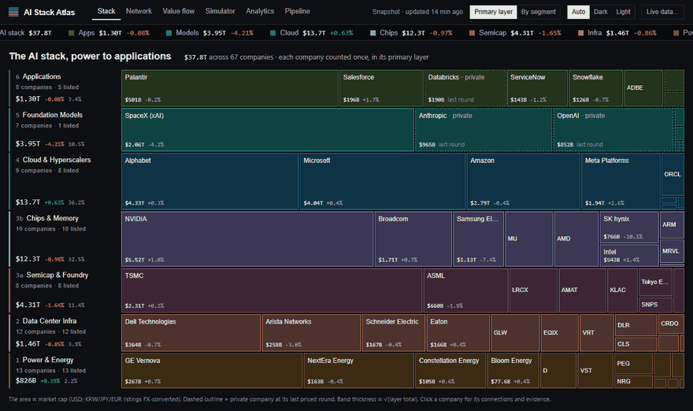
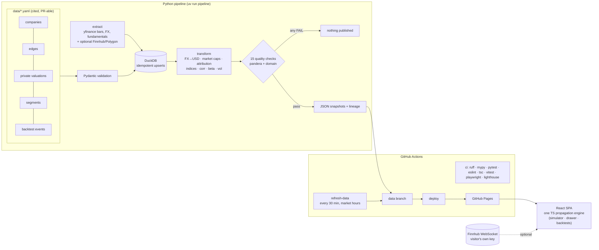

# AI Stack Atlas

**A near-real-time market map of the AI economy, power plant to application — with every
dependency cited and a transparent model of how shocks travel through it.**



**Live demo:** https://pranavparuchur1.github.io/ai-stack-atlas/ · works with zero API keys

The AI economy is a stack: utilities sell power to data centers, which house chips made with
equipment from a handful of toolmakers, rented out by clouds to model labs, whose models end up
inside applications. AI Stack Atlas puts $37.8T of it on one screen — 67 companies across 7
layers, priced from a pipeline that refreshes every 30 minutes in market hours — and connects
them with 118 relationships (equity stakes, compute contracts, PPAs, foundry and memory supply),
each linked to its filing or press release. Click a company to see what it depends on and who
depends on it; trigger an event (*"Anthropic IPOs at $1.5T"*) to see which companies move, by
how much under an explicit model, and **why**, one cited edge at a time — then check how that
model has done against real 2026 events.

> **Illustrative model, not a forecast or financial advice.**

## What's inside

| View | What it shows |
|---|---|
| **Stack** | Seven layer bands, Power at the bottom to Apps at the top; tile area ∝ market cap; private companies dashed at their last round. Toggle *primary layer* vs *split by revenue segment*. |
| **Network** | Dependency graph in layer lanes; click a node to trace N hops upstream/downstream. Edges styled by relation, width by reported $, dashed if estimated. |
| **Company drawer** | Price chart, market cap, layer share, every connection with its evidence link, exposure rankings, correlation/beta to each layer index. |
| **Simulator** | IPO / valuation change / earnings / supply shock / demand shock. Ranked impacts with $ change and why-chains, a hop-by-hop ripple, a layer waterfall, and sliders for every assumption. |
| **Backtest** | Three verified 2026 events replayed without look-ahead and scored against SPY-adjusted returns and a do-nothing baseline. |
| **Value flow** | Sankey of disclosed contracts, annualised, from payer to supplier. |
| **Analytics** | Cap-weighted layer indices, a correlation heatmap clustered by layer, event studies. |
| **Pipeline** | Run status, freshness, all 15 data-quality checks, row counts, lineage DAG, run history. |
| **Live mode** | Paste your own Finnhub key (kept in your browser only) to stream trades for the 50 largest US listings. |

## Architecture



* **One contract:** Pydantic models → JSON Schema (`schema/`) → generated TypeScript types; CI
  fails if either drifts.
* **One engine:** the propagation model exists once, in TypeScript, and powers the simulator,
  the drawer's exposure lists and the backtests (the pipeline only prepares backtest inputs).
* **Clean history:** scheduled snapshots are committed to a `data` branch; `main` holds code and
  a seed snapshot so a fresh clone runs offline.

## Data sources

| Data | Source | Notes |
|---|---|---|
| Daily prices, FX, shares, revenue | [yfinance](https://github.com/ranaroussi/yfinance) | free, no key; shares = marketCap / price (listing units) |
| Intraday quotes (optional) | [Finnhub](https://finnhub.io), [Polygon](https://polygon.io) | pipeline: `FINNHUB_API_KEY` / `POLYGON_API_KEY`; site: visitor's own key |
| Relationships (118) | SEC filings, company newsrooms, CNBC, TechCrunch, Utility Dive … | each edge in `data/edges.yaml` has `evidence_url` + date; see [edge review](docs/edge_review.md) |
| Private valuations (10) | last closed, priced round | `data/private_valuations.yaml`; talks excluded |
| Segment splits (8) | 10-K / S-1 segment revenue | `data/segments.yaml` |
| Backtest events (3) | CNBC, company releases | `data/backtest_events.yaml` |

Every number in the curated data is listed next to its source in
[docs/fabrication_audit.md](docs/fabrication_audit.md).

## Methodology in brief

* **Market cap** = close × shares × FX (KRW, JPY, EUR listings converted); private companies at
  their last priced round. **Layer totals** count each company once (primary layer) or split it
  by reported revenue segments — both reconcile to the same total.
* **Shock model:** each cited edge becomes a sensitivity — mark-to-market for stakes
  (`stake × cap_investee / cap_investor`), revenue exposure for contracts
  (`elasticity × annual contract / revenue`) — then the shock spreads up to 3 hops with 0.5 decay
  per hop, blended with empirical betas for listed sources. Undisclosed values fall back to a
  labelled 2%-of-revenue assumption.
* **Backtests (honest result):** across 3 events / 54 company-events the model does **not** beat
  predicting zero on pooled error (1-day MAE 2.93% vs 2.77%). It does on the one *capex* shock
  (Alphabet, July 2026: right direction for 10/10 suppliers, ρ = 0.77). Details in
  [docs/methodology.md](docs/methodology.md#5-backtests).

Full write-up: [methodology](docs/methodology.md) · [data dictionary](docs/data_dictionary.md) ·
[adding a company or edge](docs/adding_a_company.md) · [architecture & build plan](docs/architecture.md).

## Run it locally

Requires [uv](https://docs.astral.sh/uv/) and Node 22.

```bash
git clone https://github.com/pranavparuchur1/ai-stack-atlas && cd ai-stack-atlas
uv sync
uv run pipeline                      # fetch prices, run checks, write web/public/data/*.json
cd web && npm ci
npm run dev                          # http://localhost:5173
```

The repo ships with a seed snapshot, so `npm run dev` works even before the pipeline runs.
Tests: `uv run pytest --cov` (pipeline, 97% coverage) · `npm test` (engine) ·
`npm run test:e2e` (Playwright smoke).

## Limitations

* **Coverage ≠ completeness.** 118 well-documented relationships; most supply relationships are
  never itemised publicly. A missing edge is not evidence of no relationship.
* **79 of 118 edges have no disclosed $ value**; the model uses a labelled assumption for them.
* **Private marks are stale by construction**; five are more than a year old (flagged).
* **Evidence dates ≠ start dates**, share counts are held constant over the 1-year window, and
  revenue is today's TTM — including inside backtests.
* **Small backtest sample** (3 events), noisy windows, and one parameter tuned on them.
* The Models layer index is one company (SpaceX, listed June 2026).

## License

[MIT](LICENSE). Data is provided as-is for research and education; check primary sources before
relying on any figure. **Not financial advice.**
